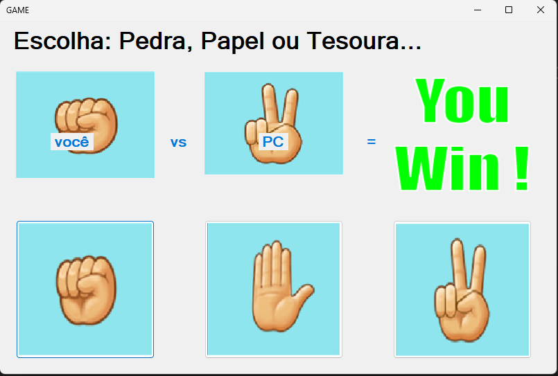

# ✊✋✌️ JoKenPo

Jogo de **Pedra, Papel e Tesoura** feito em **C# com Windows Forms**. O jogador escolhe sua jogada clicando em um botão e o computador responde com uma jogada aleatória.



---

## 🎮 Como jogar

1. Clique em **Pedra**, **Papel** ou **Tesoura**.
2. O computador faz a jogada dele automaticamente.
3. A tela mostra as duas jogadas lado a lado e o resultado: **Ganhou**, **Perdeu** ou **Empatou**.

### Regras

| Jogada | Vence | Perde para |
|---|---|---|
| ✊ Pedra | Tesoura | Papel |
| ✋ Papel | Pedra | Tesoura |
| ✌️ Tesoura | Papel | Pedra |

---

## 🛠️ Tecnologias

- **C#**
- **Windows Forms**
- **.NET** (Windows Forms)
- **Visual Studio**

---

## 📁 Estrutura do projeto

```
JoKenPo/
├── JoKenPo.sln          # Solução do Visual Studio
├── JoKenPo.csproj       # Arquivo do projeto
├── Program.cs           # Ponto de entrada da aplicação
├── Game.cs              # Lógica do jogo (jogada do PC e regras)
├── Form1.cs             # Tela do jogo (FormTelaGame): eventos dos botões
├── Form1.Designer.cs    # Layout da tela
├── Properties/          # Configurações do projeto
└── Resources/           # Imagens das jogadas e dos resultados
```

### Como o código está organizado

- **`Game.cs`**: separa a lógica da interface.
  - `enum Resultado` define os resultados possíveis: `Ganhar`, `Perder` e `Empatar`.
  - `JogadaPC()` usa `Random.Next(3)` para sortear a jogada (0 = Pedra, 1 = Papel, 2 = Tesoura).
  - `Jogar(int jogador)` compara as jogadas e retorna o resultado.
- **`Form1.cs`** (classe `FormTelaGame`): cada botão chama `StartGame()` com o número da jogada. O `switch` sobre o resultado define a imagem de vitória, derrota ou empate.

---

## ▶️ Como executar

**Pré-requisitos:** Windows e Visual Studio com a carga de trabalho **Desenvolvimento para desktop com .NET**.

```bash
git clone https://github.com/darlanrosendo/JoKenPo.git
```

1. Abra o arquivo `JoKenPo.sln` no Visual Studio.
2. Pressione **F5** para compilar e executar.

> ⚠️ As imagens ficam na pasta `Resources/` e precisam estar com a opção **Copiar para Diretório de Saída = Copiar se for mais recente**. Sem isso, o jogo não encontra os arquivos ao rodar.

---

## 📚 O que aprendi

- Criar interfaces com Windows Forms e tratar eventos de clique
- Separar a lógica do jogo (`Game`) da interface (`Form1`)
- Usar `enum` para representar estados
- Gerar números aleatórios com `Random`
- Usar propriedades com `private set`
- Trabalhar com `switch` e carregar imagens com `Image.FromFile`

---

## 🚀 Melhorias futuras

- [ ] Placar com vitórias, derrotas e empates
- [ ] Botão para zerar o placar
- [ ] Carregar as imagens uma única vez em vez de a cada rodada
- [ ] Modo "melhor de 3"

---

## 👤 Autor

**Darlan Rosendo**
[GitHub](https://github.com/darlanrosendo)
